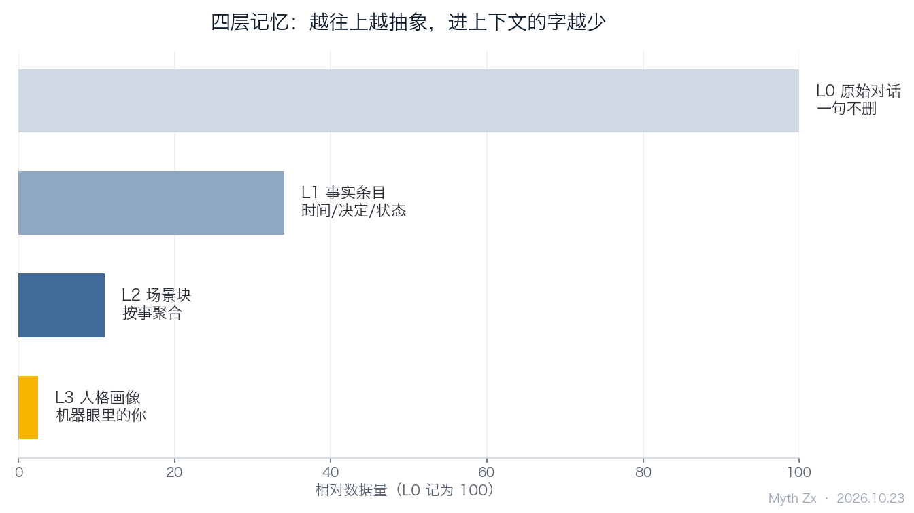
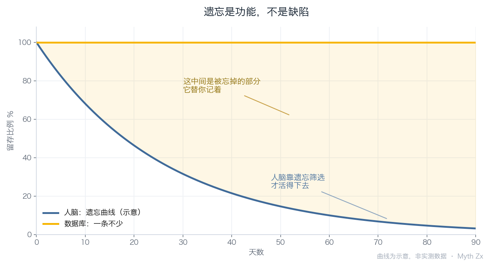

上周有件事我想不起来。摩旅那条线，是从乌海往西拐去额济纳，还是往东走大同，我一点印象都没有。手机相册翻了十几分钟，聊天记录也翻不到。最后我随口问了句我的 AI。

它两秒回我：八月二十七号你说先走西线，因为十月的胡杨林；你还补了一句「油钱不够就先到临河」。

我盯着这句话看了很久。不是因为它答得快，是因为那句「油钱不够」的语气太像我了——丧气，但又是真的在算账。

四层记忆结构：越往上越抽象

## 一、大模型其实没有记忆

大多数人以为 AI 记得自己，其实是同一个会话窗口还没关。上下文窗口是短期记忆，token 一满就从头往前丢；会话一结束，一切归零。第二天你换个窗口再问，它对你一无所知，还会很礼貌地问你想聊点什么。

这不是 bug，是架构决定的。模型本身是一堆权重，权重里没有「你」这个东西。所谓记忆，全靠外面挂一个存储层：每次对话前把相关内容捞出来，塞进提示词。听着简单，做起来全是坑。

## 二、我给它搭了四层，最难的是第二层

三个月的三个答案

我的做法是分四层存。

**L0 原始对话**：一句不删地存。作用只有一个，出问题能回溯——某天它答得离谱，我要能查到它当时到底看到了什么。

**L1 结构化抽取**：把「我说过什么」拆成事实条目，时间、人物、决定、状态各归各位。比如「十月二十一号，微信读书登录失败，改用云展网试读补完第三章」。这一步把散文变成了数据。

**L2 场景块**：按场景聚合成块。这是最关键的一层，也是我踩坑最久的一层。

一开始我图省事，所有东西全量塞进去。结果问它「我日语学到哪了」，它给我捞回来一堆食堂吃什么、宿舍几点熄灯的废话。因为在全量存储里，「日语」这个词可能出现在任何一次闲聊里——我说「学完日语再看这本」，那条记录就被算成了相关。

遗忘是功能，不是缺陷

后来改成按场景聚合：升学与赴日、课程作业、技术项目、出行、游戏消费，一块一块单独长。命中率立刻不一样了。检索要的从来不是「所有提到 X 的句子」，是「关于 X 的那一整件事」。

**L3 人格画像**：从上面三层归纳出来的「你是谁」。这层最有意思，也最危险。

分层还顺手省了钱。每次对话只捞 L2 的命中场景块加 L1 的相关条目，几百字进上下文，而不是把 L0 全量硬塞。同样的效果，token 差一个数量级。

## 三、它给我写的画像，我看着不太舒服

它总结我：追求全链路闭环，工程严谨，结果导向。

我第一反应是不服。这不像我，这像我最近一个月说话的方式。人被记录得足够多之后，机器给出的不是你的本质，是你的平均值。你某几天心情好、话多、爱用某个词，它就把那个词记成你的性格。

更麻烦的是它不会忘。

人脑的遗忘不是故障，是筛选。我忘了谁在哪天说过什么难听话，所以还能跟那个人坐一桌吃饭。数据库不忘，它把我每一次自相矛盾都并排放着：八月我说必须本地部署，九月我说云上够用、免费模型就行，十月我又转回本地量化。三条都在，时间戳清清楚楚，谁也不比谁更真。

人是靠不断改写记忆活下来的。它替我保留了所有版本，包括我不想认的那些。

## 四、记忆外化之后，「我是谁」变成了一个检索问题

这件事有点爽，也有点空。

爽的是我不用再靠脑子维持连续性，想不起的事问一句就有答案，比我自己的回忆准。空的是——那份连续性不再由我保管了。

以前「我是谁」是个哲学问题，得自己琢磨，得在半夜翻来覆去想。现在它是个检索问题：查一下就有了。答案来得太快，快到我没机会在中间迷路。而迷路本来就是想清楚一件事的必要成本。

我甚至怀疑，那些被记住的版本会反过来塑造我。它记着我「工程严谨」，我下次说话就更容易往严谨那边靠，慢慢地我真的变成了那个画像。不是它在模仿我，是我在照着它的摘要活。

## 五、

今天早上它提醒我写公众号。它比我准时，比我记得清楚，比我不容易情绪化。这不坏，我确实需要有人替我记着。

我只是想在它记录的边缘留一块不写入的地方。有些话说完了就该消失，像胡杨林十月一过就掉光。

今年没去成额济纳，明年再说。

至于那台机器，它继续记着，我继续忘着，我们各干各的。

---

*本文首发于微信公众号「Myth Zx」（2026-10-23），作者 Myth Zx。*
