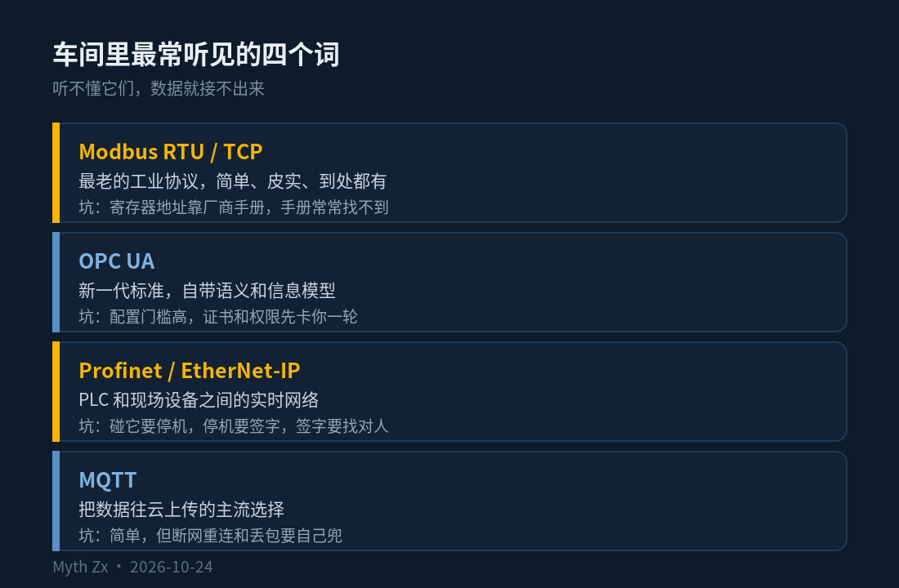
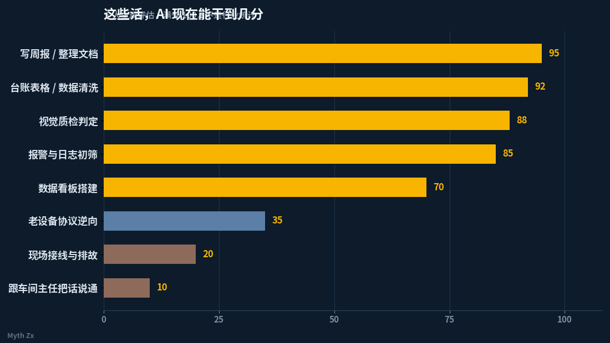
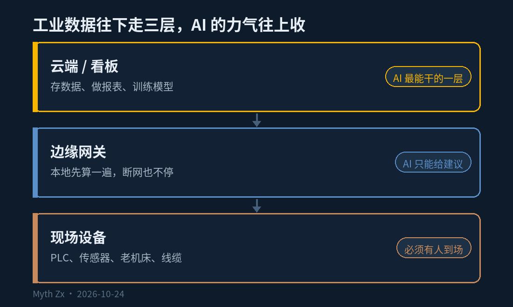

昨天下午在实训室，同学接 PLC 的供电，24V 正负接反了。上电那一瞬间，模块冒了一股白烟，全组人往后退了半步，然后开始笑。

我站在旁边看那股烟，脑子里冒出一个特别不合时宜的问题：如果今天是 AI 在干这个活，它会先关哪个闸？

## 一、我们专业到底在学什么

很多人听到「工业互联网技术」，第一反应是「哦，写代码的」。不是。

我们学的核心只有一件事：把机器说的话翻译成人能看懂的话，再把人的决定送回去。

具体是这些：传感器怎么把温度、压力、电流变成 4-20mA 或者数字信号；Modbus、OPC UA 这些协议怎么把数据读出来；边缘网关怎么在本地先算一遍再往上传；PLC 怎么写逻辑，HMI 组态怎么画；工业以太网怎么布线、怎么隔离；最后才是数据上云、做看板、做分析。

顺序很重要。前面那一大段，全在车间里，全要动手。

## 二、AI 已经吃掉的那部分，我不装看不见

诚实讲，这半年我用模型干掉的活不少。课件让它读，重点让它划，练习题让它做，错题让它讲。写脚本、调格式、改报错、生成周报、做 PPT 大纲、把一堆散乱数据整理成表，这些它比我快，而且不抱怨。

工业里也一样。视觉质检在产线上跑了快十年，早就不算新东西；报警初筛、日志归类、设备台账整理、SOP 文档，AI 已经在做，而且比人耐心。

所以我不会写「AI 取代不了人类」这种话。它取代得很实在，一份一份地取代。

## 三、但有些活，它连「想干」的资格都没有

第一个是现场本身。油污、噪音、四十度的夏天、叉车把网线压断、甲方半夜打电话说数据断了。这些问题没有一个能靠 prompt 解决，你得带万用表、带笔记本、带一把螺丝刀过去。

第二个是责任。一台设备停一小时，损失几万块起步。出了问题要有人签字，要有人被追责。你不会让一个模型签字，它也不会站在车间里挨骂。

第三个是老设备，这个最要命。厂里的机床常常是十年、二十年前的，私有协议，没有文档，当年写程序的人早走了，厂商都找不到了。数据接不出来，八成不是算法不够好，是那台机器压根不给你开口。这种活得一家一家去磨。

第四个是沟通。车间主任不关心你的模型准确率是 98% 还是 99%，他关心的是你懂不懂这台机器的脾气，会不会在他赶订单的时候来拔他的线。

## 四、我真正的焦虑，其实不是「被替代」

这段时间我一直在想一件事，越想越清楚：我焦虑的不是 AI 抢我的活，是我不确定自己愿不愿意成为「必须去现场」的那种人。

在宿舍写脚本很舒服。空调、椅子、一杯水，随时能躺下。但工业互联网价值密度最高的地方，在车间、在矿区、在没人愿意去的现场，夜班、出差、满身灰。

日本那条线也是同一个逻辑。他们缺的从来不是会调 API 的人，是愿意进现场、能看懂设备、能跟老师傅把话说通的人。语言是门票，技术是本事，愿意去才是前提。

这个专业不会消失，它会分层。上面一层做分析，坐办公室，卷得厉害，AI 也在抢；下面一层能把数据真正接通，缺人，短期补不上。

## 五、我现在在做的三件小事

第一，工具少学一点，接口多摸一点。工具三个月换一茬，Modbus 的寄存器地址二十年没变。

第二，把手边能接的东西都接上。宿舍的温湿度、空压机的电流、实验室那台老设备的串口。数据从哪来、怎么进来、丢包了怎么办，这些坑只能自己踩。

第三，日语每天啃一点。理由很现实：那是另一张门票。

昨天那股白烟最后没烧坏什么，换个模块就好了。我把它记在一张纸上，贴在工具箱里：接线前先确认电源。

AI 现在能替我写这篇文章的开头，能替我算 24V 接反的后果，甚至能替我查那个模块的型号。但它不会知道，那股烟飘起来的时候，一屋子人往后退了半步，然后笑了。

那种笑，得在现场才笑得出来。

---

*本文首发于微信公众号「Myth Zx」（2026-10-24），作者 Myth Zx。*
