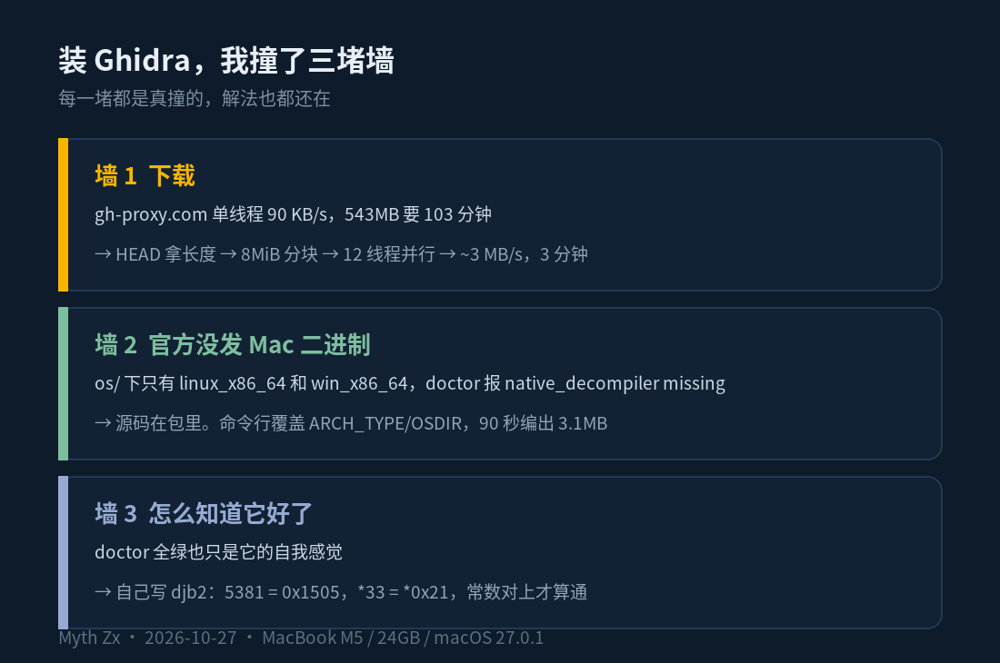

上周我想干一件早就想干的事：拆开 MuMuPlayer 看看。一个 1.5GB 的商业安卓模拟器，装在我 Mac 上，调度着一整台虚拟机，我想知道它到底是怎么跑的。

拆的第一步是反编译。Ghidra 是绕不开的那个——NSA 开源的，免费，反编译质量比 IDA 的免费版强。装它，然后我撞了三堵墙。

## 第一堵墙：543MB，下载要 103 分钟

Ghidra 的发布包在 github 上，github 在这边打不开。能用的镜像只有一个 gh-proxy.com，实测单线程 90 KB/s。543MB 除一下：103 分钟。这还只是第一个包，后面还有一个 JDK。

解法不新鲜：分块并行。先 HEAD 拿到 Content-Length，切成 8 MiB 的块，12 个线程同时拉，哪块没下完补哪块，最后拼起来，对 SHA-256。12 路跑满大概 3 MB/s，103 分钟变成 3 分钟。

两个坑值得记一下。一是这个镜像重试的时候会无视 Range 头，直接把整个文件从头吐给你——所以补块之前先看已下文件的大小，万一它就是完整的呢。二是进度条卡在「总量减一块」、速度一路衰减、进程还攥着一个 ESTABLISHED 连接，那不是慢，是有一块在无限重试。杀掉，看缺哪块，单独 curl 那一块，通常它会把完整的文件吐回来。

JDK 的坑更隐蔽：Temurin 的下载地址由 api.adoptium.net 给出，但直链指向 github.com，照样打不开——把域名换成 gh-proxy.com 就行。另外别想着 brew install openjdk@21，它要拉 20 多个依赖 bottle，走的还是同一条龟速链路；官方 tarball 200MB，零依赖。

## 第二堵墙：装完了，官方没给 Mac 反编译器

包下好，解压，跑 doctor，一句 native_decompiler missing，后面所有 Ghidra 查询全部失败。

去看安装目录的 Ghidra/Features/Decompiler/os/，底下只有两个文件夹：linux_x86_64 和 win_x86_64。也就是说，Ghidra 12.1.4 的官方发布包里，根本没有 macOS 的反编译器二进制。Mac 用户拿到的是一个不能反编译的反编译工具。

但源码在包里。

decompile/cpp 底下就是完整的 C++ 源码，配着 makefile。打开一看，Darwin 那一段写得清清楚楚：

> ifeq ($(OS),Darwin)
>   ARCH_TYPE=-arch x86_64
>   OSDIR=mac_x86_64

写死 x86_64。这是 Intel Mac 时代的遗物，而且就算是给 Intel 编的，官方也没把它编出来放进包里。

好消息是 GNU make 允许命令行覆盖文件里的赋值。两个参数：

> make -j8 ghidra_opt ARCH_TYPE="-arch arm64" OSDIR=mac_arm_64

90 秒，一个 3.1MB 的 decompile 出现在 os/mac_arm_64/ 底下。装回去，doctor 全绿。

## 第三堵墙：全绿的 doctor 也会骗人

工具装好了，怎么知道它真的能用？我没去拿什么大程序试手，先给自己出了一道题：写一个几行的 C 函数，里面藏两个只有我知道的常数，编译，再让 Ghidra 反编译回来，看常数在不在。

函数是 djb2 哈希，写过字符串哈希的人都认识：h 初值 5381，每来一个字符，h = h * 33 + c。5381 和 33 就是我要找的两个数。

> clang -O0 -arch arm64 -o demo demo.c

必须 -O0。-O1 之下 clang 会把这种小函数直接内联掉，你要反编译的那个函数根本不存在。

然后反编译 _checksum。注意那个下划线——Mach-O 的符号表习惯在 C 符号前面加一个下划线，Ghidra 忠实地照收，你写 checksum 它就告诉你查无此人。

今天我又跑了一遍，伪代码原样出来，0x1505 就是 5381，*0x21 就是乘 33。源码里的两个常数，一个不少地出现在反编译结果里。到这一步我才敢说这东西是通的——doctor 说绿是它的自我感觉，这个对上才是真的。

## 然后才是正片

链路验证完，我把 MuMuPlayer 整个丢进去，Ghidra 挖出 60330 个函数。1.5GB 的包，塞进 24GB 统一内存的 Mac，一次跑完。

中间又踩一个：Ghidra 默认的启动等待是 330 秒，十几 MB 的 Swift 程序带着一堆元数据，超过这个时间直接报 provider_timeout，看起来像分析失败，其实是没等完。export REA_GHIDRA_STARTUP_TIMEOUT_MS=1500000，再配 GHIDRA_HEADLESS_MAXMEM=6G，稳。

## 写在最后

回头看这三堵墙挺有意思的：第一堵是网络，第二堵是官方漏发的二进制，第三堵是「你怎么知道它好了」。前两个靠力气能过去，第三个最值钱——它逼你想清楚你要的到底是什么结果。

还有一件事我挺喜欢：官方没给 Mac 版，但源码随包发了。源码在包里，就不算没给。这跟你下载了个残缺的安装包完全是两回事——它给了你全部的材料，只是没替你把最后 90 秒跑完。

逆向这扇门，第一次推开它用的工具是自己编的，这件事本身就挺让人上瘾。

---

*本文首发于微信公众号「Myth Zx」（2026-10-27），作者 Myth Zx。*
