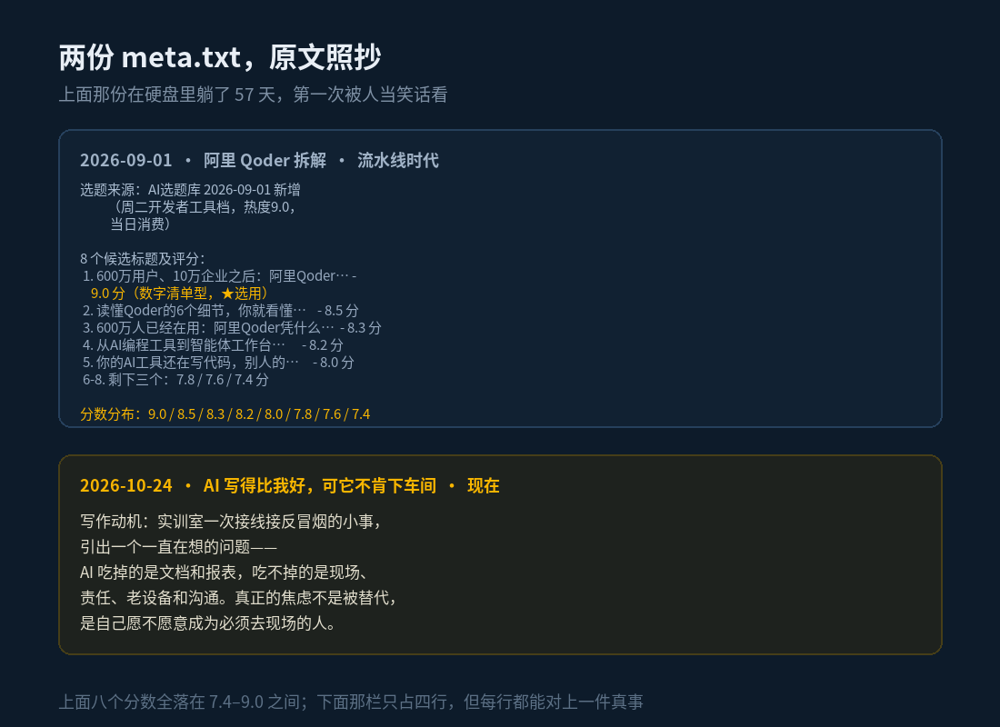

昨晚没什么事，我把这个号的存档目录从头翻了一遍。03_已发布文章，按月份分文件夹，从 2026-06 到 2026-10，一共 42 个子文件夹。每篇的 article.html、cover.png、meta.txt 都还躺在里面。

翻到一半我发现一件事：这个号是两个人写的。

## 36 篇，全是别人家的事

2026 年 6 月 18 日第一篇，《DeepSeek 500 亿融资背后》。到 9 月 14 日最后一篇《ClaudeCode 额度新规算账》，中间整整 36 篇。我把 36 个标题排成一列看：DeepSeek、Gemini、GPT、国产 AI 芯片、黄仁勋、WAIC、Qoder、英伟达、苹果……没有一篇例外，全是别人家的事。

字数也稳得吓人。35 篇能读到正文的（还有 1 篇只存了封面，正文没落盘），每篇中文字数平均 2336，中位数 2346。三个月，上下浮动基本不超过正负 500。这不是写作，这是产能。

当时的流程在 meta.txt 里留着全尸。9 月 1 日那篇的 meta 写着：「选题来源：AI选题库 2026-09-01 新增（周二开发者工具档，热度 9.0，当日消费）」。「当日消费」四个字现在看尤其好——一个选题领出来，用掉，销账，跟车间领料一模一样。

最精彩的是标题环节。那会儿每篇要出 8 个候选标题，挨个打分。9 月 1 日那篇的八个分是：9.0、8.5、8.3、8.2、8.0、7.8、7.6、7.4。现在再看这个分布——铺得比血压曲线还平。真人打分不会这样，真人会打出 9 分和 4 分，会有一个标题因为「太油了」直接给 2 分再划掉。八个全挤在 7.4 到 9.0 之间，说明打分的那个东西对这些标题根本无感，它只是在完成「排出个顺序」的动作。

最后选中的是《600万用户、10万企业之后：阿里Qoder智能体工作台的6个关键细节》。标题没毛病，真没毛病——数据是真的，六条信源能查，讲得也清楚。它只是跟「我」没有任何关系。

## 中间空了 39 天

9 月 14 日之后，这个号停了。下次更新是 10 月 23 日，中间隔了 39 天。

那 39 天其实没闲着，只是话都说到别处去了：装 Ghidra、自己编反编译器、搭一整套定时调度、翻自己三百多天的健康数据。产出一直有，唯独没往这个号上放。现在回头看也说得通——那些事当时还没沉淀成「我能写的题」，而选题库也不可能收录「我给自己的硬盘写了个告警」，这种题没有热度分，领不出来。

## 回来以后

10 月 23 日回来，第一天就发了两篇。到昨天一共 6 篇，平均 1558 字——比流水线时代少了三分之一还多。

字数是少了，但 meta.txt 里多了一栏以前从来没有的东西：「写作动机」。

10 月 24 日那篇的动机：实训室一次接线接反、冒了个烟。10 月 27 日那篇的动机：装 Ghidra 连撞三堵墙，最后一赌气自己编了个反编译器。10 月 26 日那篇的动机：让派蒙把硬盘的 SMART 告警念给我听。10 月 25 日那篇的动机：翻出 316 天的手机计步，发现「我每天走 7 公里」这个自我认知是错的，真达标的日子只有 11%。

六篇里也有一篇清单（10 月 23 日，五个工具），题材上跟旧时代没区别——那篇其实是选题库出的最后一道题：复活当天它还被更新过一次，表里那条记录标着热度 8.8。区别只在那篇是挨个装过、把「官方没说清的事」标出来的，跟以前「转述六条信源」的清单不算一种东西。姑且算它过来潜伏的。

## 哪种活法对，我不装中立

直接说：流水线那三个月没白跑。核信源、把复杂东西讲明白、每天准时交稿——这套手艺留到现在还在用，今天这篇的统计就是写脚本把 42 个文件夹挨个数出来的，不是拍脑袋。旧文章放今天也不算骗人，数据真，来源可查。

但流水线有个比「无聊」更狠的问题：它让「完成」变得太容易了。每天早上选题库滚出一个题，打分，凑字，交差，日更率 100%。人最容易在「一切正常」的时候停止走心——连着 36 篇正常产出，没有一篇需要我本人在场。

10 月这 6 篇反过来，篇篇都要我在场：线是我接的，反编译器是我编的，计步数据是我自己的，SMART 告警是我硬盘的。写错了我第一个知道，糊弄不过去。

选题库那个 xlsx 还在硬盘上，没删。最后一次被动是 10 月 23 日，之后到今天，再没打开过。

42 个文件夹排在那儿，像一排柜子。前 36 个我路过，后 6 个我住过。

明天写什么还没想好。这次不打算先打分了。

---

*本文首发于微信公众号「Myth Zx」（2026-10-28），作者 Myth Zx。*
