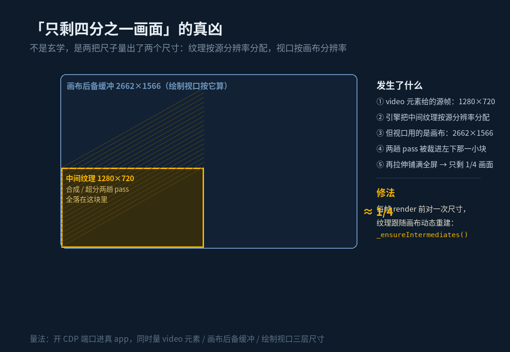

我想在 Mac 上串流玩 Xbox。官方的 xbox.com/play 网页版能用，但那是网页的体验。第三方客户端里 Midori 做得最体面：7.7MB 的原生程序，走的还是 Xbox 官方链路——设备码登录、XSTS 换票、gssv 串流，视频走 LiveKit WebRTC。毛病只有一个：好功能全锁在 Premium 后面。

之前拆它的时候我把底摸清了：Premium 卖的东西全是客户端后处理——4K 上采样、锐化、120fps 插帧、码率控制、手柄震动、Zoom/Fill/环境光这些视图模式。串流的源头在微软那边，谁都拿不走；但这些「画质增强」是本地跑的代码，理论上谁都能自己写。

破解这条路我从一开始就没打算走。不是清高，是不想把「能用」这件事建立在一个下次更新就会碎掉的补丁上。所以我给自己出了道题：这些功能里我真正要的是哪几个，我写不写得出来。

## 骨架用现成的，引擎自己写

底座选了开源的 XStreaming-desktop（MIT 协议），它的鉴权和串流链路是通的，省下我几周时间。但打开设置页一看，画质相关的选项几乎是空的——上游根本没做后处理引擎。

于是重活变成：写一个引擎。1498 行 WebGL2，跑在串流页的主世界里，从 video 元素抓帧，过一遍自己的管线再画到画布上。四个模式：关、锐化、超分、插帧。插帧给两条算法——运动补偿和帧混合；超分用 AMD 开源的 FSR 1.0（EASU 上采样加 RCAS 锐化）。输出档位做到 4K（3840×2160 超采样），刷新率档从 60 一直排到 240。

有个细节我挺喜欢：超分方案默认「跟随显卡」。引擎启动时读 WebGL 的 renderer 字符串，认出这是 N 卡、A 卡、I 卡还是 Apple GPU，设置页把检测到的显卡型号亮在最上面，再给对应建议。建议里有一句是诚实的：N 卡用户可以去驱动面板开视频超分辨率，但 DLSS 和 XeSS 别指望——那俩要引擎级运动矢量，串流协议根本不会给你。引擎里还留了个空位：NIS 还没移植，所以「跟随显卡」目前一律先落到 FSR。

设置页照着 Xbox 主机的样式重做了一遍：左边竖排八个分类，选中项亮一根绿色竖条，右边是内容板。顶部中间挂着 KUJIRA 和 v0.1.0，右边是我的 gamertag。

## 一个晚上，三颗雷

写功能是顺利的，翻车全在联调。

第一颗雷是我自己埋的。TURN 服务器的凭据，规范里那个字段叫 credential，我写成了 password。RTCPeerConnection 构造时直接抛错，把后面整个 bind() 连环炸死——表现出来就是「连不上」，跟 NAT 一点关系都没有。修完顺手加了兜底：TURN 配置就算整个是坏的，也自动回落原生 ICE，不能因为中继配置把串流挡死。

第二颗雷是上游的，而且只在冷启动炸。router.query.serverid 在路由就绪之前是 undefined，恢复上次串流地址一重载，.startsWith 一碰就死。我看到的现象特别迷惑：画面只剩四分之一。那其实是渲染中途死掉的残骸——页面挂了，布局停在半路。

但「四分之一」还有第三个凶手，也是最硬核的一个。前两颗雷修完，插帧和超分一开，画面还是只占四分之一。这次不猜，开着调试端口进真 app 量三层：video 元素 1280×720，画布后备缓冲 2662×1566，而中间纹理——合成和超分那两趟 pass 要落脚的地方——是按源分辨率 1280×720 分配的。视口却按画布的 2662×1566 来。两趟 pass 全被裁进左下角那一小块，再拉伸铺满全屏，可不就是四分之一画面。改成中间纹理跟随画布尺寸动态重建，每帧 render 前对一次尺寸，好了。

顺带把 NAT 那关也过了：打洞打不穿就走 TURN 中继兜底，现在挂的还是免费 Open Relay，验收完可以换自己的中继。

## 收官那晚顺出来的两个 bug

功能齐了之后我下了道命令：全站排查。七个页面开着调试端口扫控制台，抓到两个真 bug，都不是新代码的锅。

一个是设置存档丢字段。主进程存档是「默认值加新参数」整包覆盖，渲染层任何一次不完整保存，都会把没带上的字段打回默认值。这解释了一个悬案——自动连接的主机 ID 会神秘消失。改成合并已有存档再写，缺字段永不回退。

另一个更逗：手柄测试页每两秒抛一次未捕获异常。页面在轮询一个叫 app:hidController 的动作，主进程压根没注册它——那是上游做到一半放弃的原生手柄内核。补上注册（诚实返回空状态），页面侧再兜一层捕获。修完再扫，全站零异常零报错。

引擎自检台也回归了一遍，顺手记了笔账：Mac M5 上，1280×720@60 的源，运动补偿插帧渲染 0.06 毫秒一帧，端到端延迟 16 毫秒。画质也没靠感觉吹，拿 SAD（跟基准帧的绝对差均值）量了五种做法——纯运动场景里运动补偿 1.11，帧混合 2.25，误差差着一半；但复杂场景那组，「直接用上一帧」2.71 反而最低，运动补偿 3.13。这个结果不好看，可它是真的，如实记下来。

## 为什么叫 Kujira

名字用了日语的「鲸」（くじら）。一来我在学日语，二来这东西的性子像鲸：不快，吃得住深水，慢慢游。图标换了，包名换了，作者字段写成 Myth Zx，license 留 MIT。

昨晚 23:39 到今天 00:55，六个提交落完：默认分辨率从 720 提到 1080P(HQ)、换脸、4K 和刷新率档位、按显卡选超分、Xbox 式设置页加全站排查。仓库现在还是私有的，所以 app 里那个更新检查会 403——开源那天它自己就好了。

前天我写 AI 写得比我好，可它不肯下车间。昨天晚上算是把这句话掉了个头：方向、方案、验收是我的，盯着「中间纹理为什么只有四分之一」不肯罢休的也是我。工具堆代码很快，但快不解决那块画面。

睡之前我把 app 连上主机跑了一局。画面铺满全窗，环境光溢出染红了墙，插帧开着，延迟 16 毫秒。Midori 的 Premium 我还是没打算买——现在我有 Kujira 了。

---

*本文首发于微信公众号「Myth Zx」（2026-10-29），作者 Myth Zx。*
