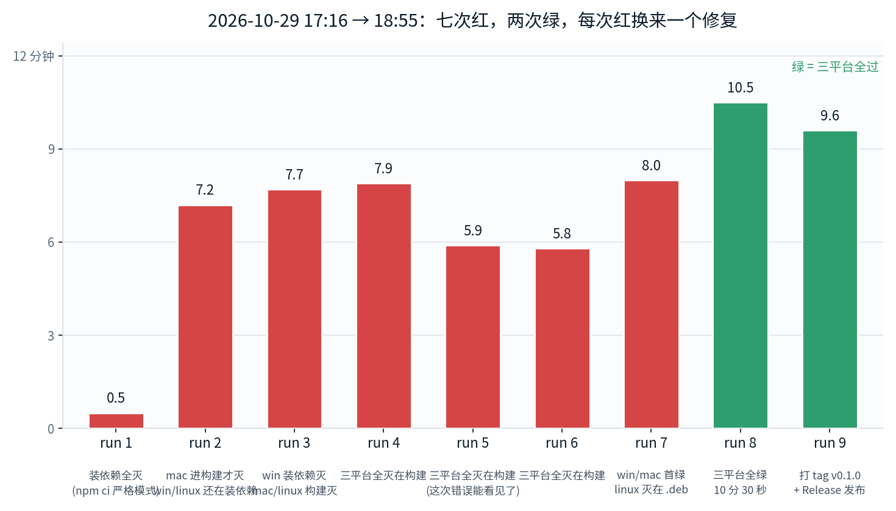
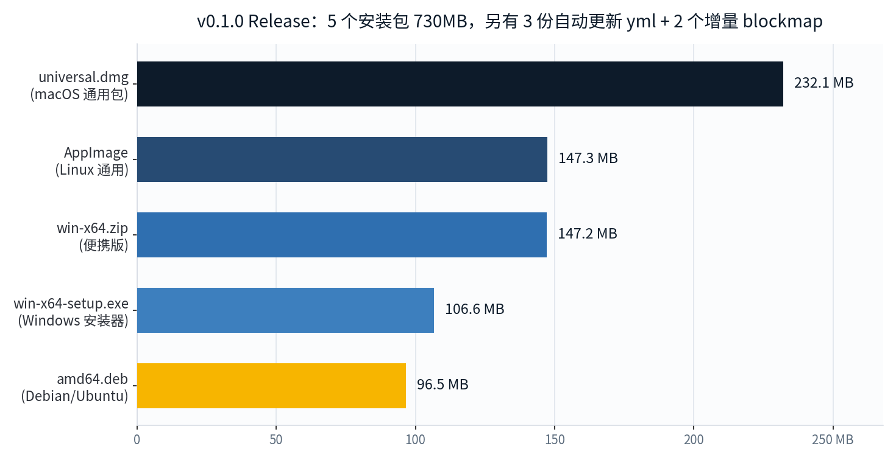

28 号夜里我把串流引擎写完了，1498 行 WebGL，跑在自己机器上。但「跑在自己机器上」和「别人能下载」之间，隔着一个我最不熟的工种：发版。29 号白天一整天干的就是这件事。结果先说：v0.1.0 出包了，GitHub Release 上挂着 10 个文件，730MB，Windows、macOS、Linux 三平台一次出齐。代价是 CI 连红七次。

## 发版前，先埋掉三颗雷

第一颗是自己埋的。早上我给页面导航加了锁——除了微软登录链路，别的跳转一律拦，安全加固嘛。结果中午登录页直接冻住：微软的 auth 链一环都不在白名单里，加固加出了负效果，老老实实补白名单。

第二颗最有意思。之前有人说菜单按钮「有时候会消失」，含糊其辞查不下去。这次顺着 z-index 一层层翻，真凶浮出来：2147483000。插帧引擎的画布挂在 2^31 的层级上，盖住整个画面。它设了 pointer-events:none，点是能点到的，但只要插帧一开，按钮在视觉上就被游戏画面活埋了。「有时候」的原因也清楚了——后处理关掉时画布不显示，按钮就好好的。改到 10，低于 UI 层，完事。

第三颗是 4561fps。手动设了帧率上限不生效，HUD 上跳着 4561Hz，卡成幻灯片。查出来三个 bug 叠在一起：设置页读出来的 '120' 是字符串，代码拿 typeof === 'number' 去判，手动上限从来没生效过；渲染循环的限频判断放在 layout() 后面，不限频时每秒几千次布局重排，这才是卡顿的源头；还有 Chromium 的 appendSwitch 根本传不到 GPU 进程——实测 rAF 只有 54，把开关直接写进启动命令行重启，rAF 立刻 2958。这个 app 现在会带着参数把自己重启一次，还留了个哨兵参数防止无限重启。

## 然后开始配 CI，连红七次

包不能在自己机器上打。Mac 打的 dmg 别人装要过 Gatekeeper，Windows 和 Linux 的包我压根没有构建环境。目标定得很清楚：GitHub Actions 三平台矩阵，推 main 出测试包，打 v* 的 tag 出正式 Release。上游那份 workflow 是给上游用的，删掉 173 行，换上我自己的 60 行。然后就开始红。

**第一次，三平台全死在装依赖。**npm ci 的严格模式被 HeroUI 的 peer 依赖范围呛住——本地开发从来都是 --legacy-peer-deps 跑的，干净环境一秒翻脸。换成 npm install --legacy-peer-deps。第二次灭点挪到了构建步，Linux 还有个独有的坑：node-hid 走源码编译，缺 libusb/libudev 的头文件，apt 装上。

**接下来最憋屈的不是红，是看不见红在哪。**日志 API 对这个 token 返回 403，我不想在网页里一层层点开每个 job 的每一步。于是换思路——看不到日志，就让失败自己说话：npm 挂掉时，把它最新的日志尾巴写进 step summary；构建挂掉时，把 build.log 的最后 25 行转成 ::error:: 注解，直接打在 Actions 的时间线上。从那以后每一次红，原因自己蹦出来，不用我去找。

**然后就是排雷，一颗一颗。**第一颗：postinstall 里的 electron-builder install-app-deps，干净环境里必炸，删掉。第二颗：nextron 构建内部会初始化 GitHub publisher，拿不到 GH_TOKEN 直接抛异常，把 token 传进去——这一步之后，Windows 和 macOS 同时绿了。第三颗：只剩 Linux 还红，不是环境问题，是 electron-builder 死活不肯打 .deb：没有 maintainer 字段。我不想把个人邮箱写进公开的 package.json，给它一个项目级的维护者字段，了事。

第 8 次推送，18:38，三平台全绿，10 分 30 秒。18:55 打 tag v0.1.0，第 9 次跑完时是 19:04——Release 页上挂出 10 个文件：232MB 的 universal dmg、106MB 的 Windows 安装器、147MB 的 zip、147MB 的 AppImage、96MB 的 deb，还有三份自动更新用的 yml 和两个增量更新的 blockmap。仓库也转成了 public。

## 这一天的账

从 28 号 23:39 的第一个提交，到 29 号 19:04 包挂上 Release，不到 20 小时。中间红了七次，但没有一次是白红的——七次修复全部变成了 workflow 里的注释和兜底，下个版本不用再踩同一遍。

发版这件事，我以前总觉得是「写完之后点一下」。真发一次才知道它本身就是个工程：怎么让失败可见，怎么让三个平台的怪癖各归各位，怎么让下一个版本不再付今天的学费。写代码是跟一台机器打交道，发版是跟全世界所有人的机器打交道。

仓库现在是 public 的，0 star，安装包里带着自动更新的元数据——装了的人，下一版出来会自己收到。引擎是夜里写的，包是第二天发的，中间隔着七次红。这买卖不亏。

---

*本文首发于微信公众号「Myth Zx」（2026-10-30），作者 Myth Zx。*
